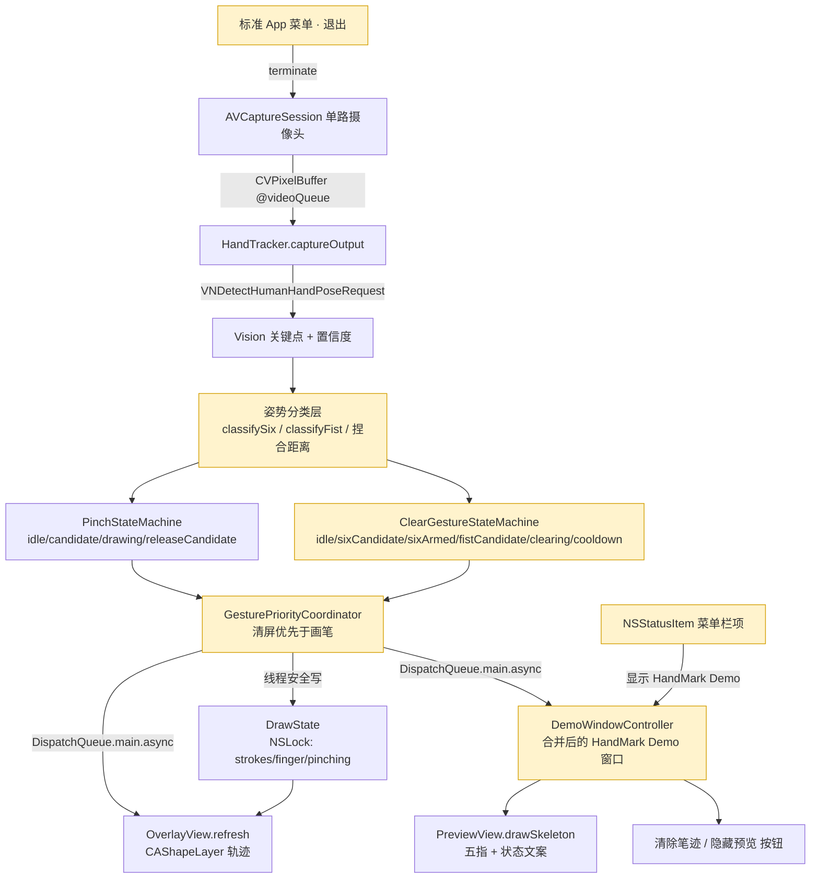
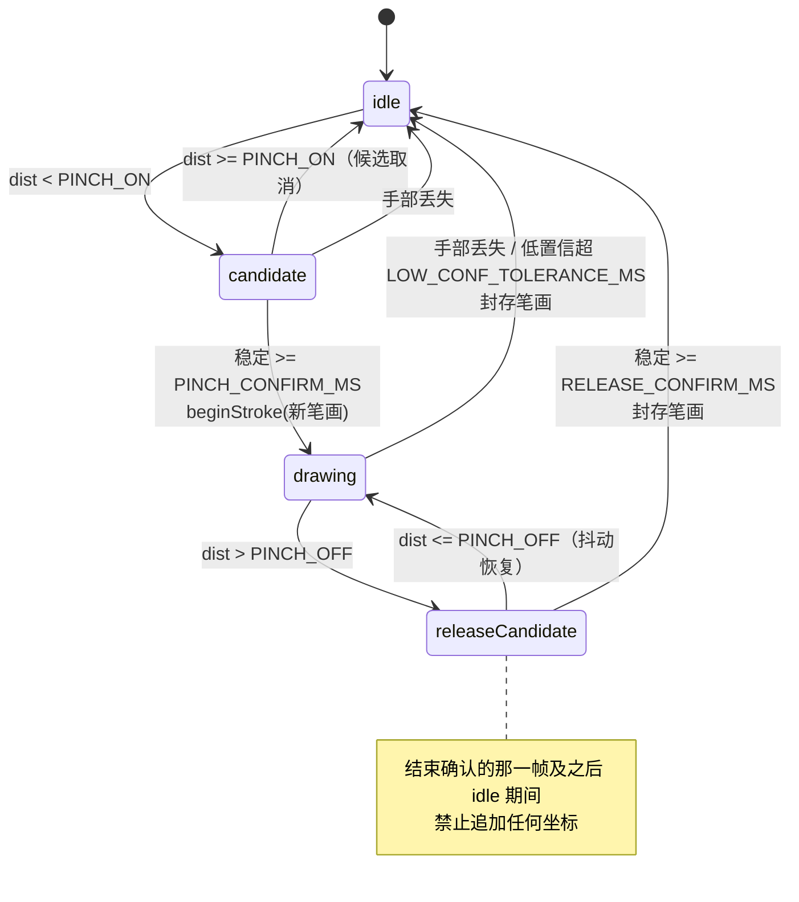
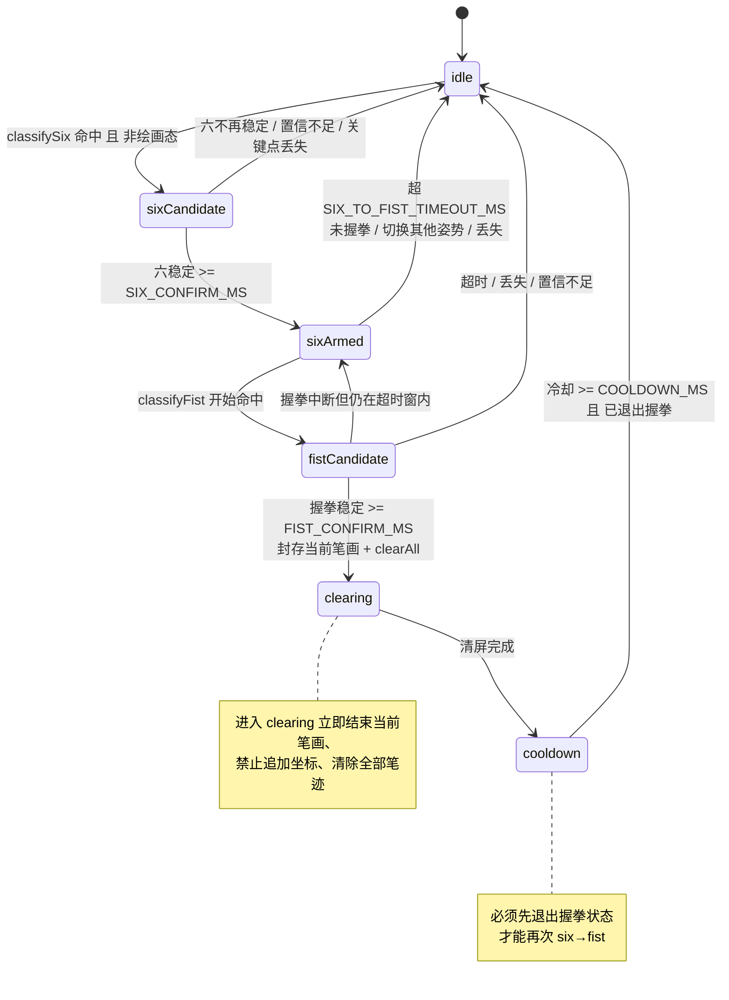
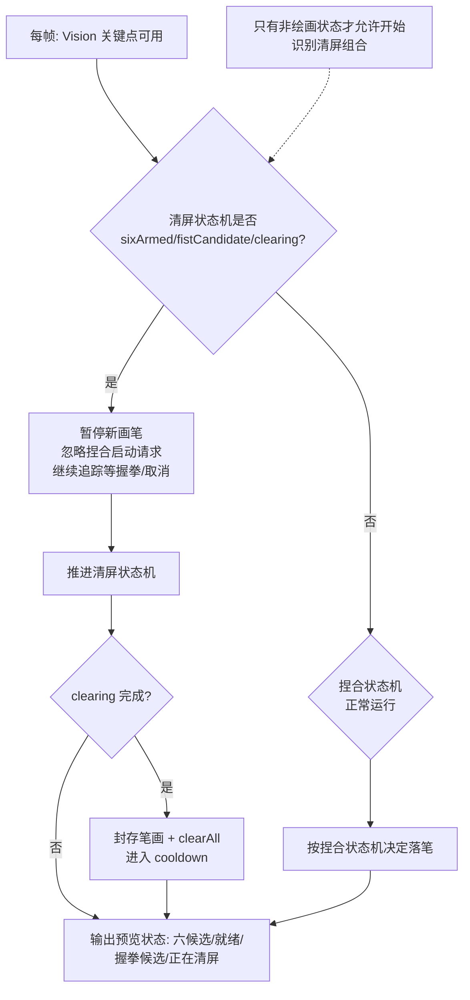
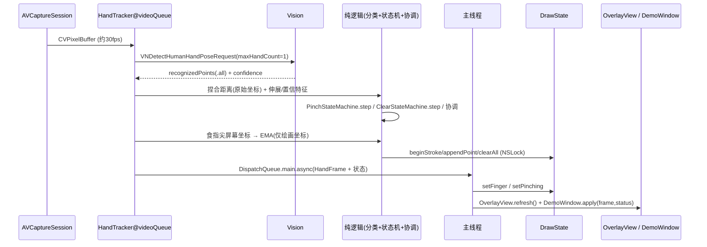

# Design Document: HandMark V1.1

## Overview

HandMark 是一个 macOS 原生隔空绘画 Demo：摄像头识别手部，拇指+食指捏合开始绘画，分开停止，轨迹以荧光笔效果叠加在全屏透明窗口上。当前代码是单可执行 SPM 目标，全部逻辑集中在 `Sources/HandMark/main.swift`（843 行），技术栈为 Swift + AppKit + AVFoundation + Vision（`VNDetectHumanHandPoseRequest`）+ Core Animation，无第三方依赖，platform macOS 13。

V1.1 在现有基础上做增量加固，共五项：(1) 画笔启动防抖（捏合迟滞 + 确认计时）；(2) 修复松开向上挑线（每帧先处理状态再落笔 + 结束帧不追加 + 丢失不连线 + 绘画坐标轻量 EMA）；(3) 合并预览窗与控制面板为单一「HandMark Demo」窗口，用标题栏红黄绿交通灯关闭、NSStatusItem 恢复显示、标准 App 菜单退出；(4) 五指关键点显示补齐清屏候选/正在清屏状态文案；(5) 新增「六→握拳」有序组合手势清屏，含状态机、1 秒超时、800ms 冷却与相对普通画笔的优先级协调。

本设计是 Design-First 工作流产物，同时包含高层设计（组件图、状态机图、数据流、窗口结构）与低层设计（类型/函数签名、算法伪代码、线程模型、测试策略、参数表）。实现原则：先理解再改、尽量复用现有类型（`HandTracker`/`DrawState`/`OverlayView`/`PreviewController`/`PanelActions`）、沿用现有命名、不做无关重构、不引入后端/数据库/联网/账号。

## 现状分析（基于真实源码）

对每一项 V1.1 需求，评估当前 `main.swift` 的满足度。所有结论均来自实际代码。

### 需求 1：画笔启动防抖

- **已满足**：`enum PinchPhase { idle, candidate, drawing }` 已是状态机；`candidate` 需稳定 `PINCH_CONFIRM_MS=150ms` 才进 `drawing`；开始阈值 `PINCH_ON=0.22`、结束阈值 `PINCH_OFF=0.35` 已构成迟滞；确认期内 `dist >= PINCH_ON` 立即回 `idle`（取消候选）；绘画坐标用食指尖（`indexTip`）；距离基于**掌宽归一化**（`computePalmScale`：`indexMCP↔littleMCP`，退化到 `wrist↔middleMCP × 0.85`，带 ±33% 合理性检查 + 0.15 指数平滑）。
- **需新增/加固**：现有 `PinchPhase` 只有三态，V1.1 要求状态至少区分 `idle/pinchCandidate/drawing/releaseCandidate/clearing`。当前「松开」是单帧 `dist > PINCH_OFF` 立即结束，没有显式 `releaseCandidate` 去抖态；`clearing` 属于清屏组合（需求 5），不应塞进 `PinchPhase`。设计决策见下方「状态机设计决策」。

### 需求 2：修复松开向上挑线

- **已满足**：`captureOutput` 已是「① 先处理捏合状态变化 → ② 再决定是否采集坐标」的顺序；`justStarted` 开始帧不追加；结束帧切 `idle` 后本帧不追加；每次确认用 `beginStroke` 新建笔画；手部关键点丢失（`guard ... indexTip/thumbTip`）立即 `phase=.idle`、`smoothed=nil`（不桥接 EMA）、绝不写入；低置信帧只跳过写入，持续 `LOW_CONF_TOLERANCE_MS=200ms` 才结束；`lastWritten/prevWritten` 做末段位移诊断日志。
- **需加固**：
  - 当前 EMA 平滑后的 `p` 同时用于 `lastTip`、写入与 `state.setFinger`。**距离 `dist` 是基于 `indexTip.location`/`thumbTip.location` 原始归一化坐标计算的，未受 EMA 影响**——这正是需求 2 要求的「平滑只用于绘画坐标，不改变手势距离判定」。设计需显式固化这一不变量，防止回归。
  - 丢失/低置信时「不得用直线连接丢失前后两点」当前已靠「丢失即结束 + EMA 清空」实现，但**没有显式单测**覆盖。需抽纯逻辑可测。
  - 引入 `releaseCandidate` 后，结束判定从「单帧 `dist>PINCH_OFF` 即结束」改为「`dist>PINCH_OFF` 进 `releaseCandidate` 去抖，稳定短时窗才封存」，需确保「确认结束的那一帧及之后 idle 期间禁止追加」的不变量保持不变。

### 需求 3：合并预览与控制面板

- **现状**：预览是独立 `PreviewController`（`NSPanel`，标题「HandMark · 摄像头」），控制面板是独立 `makeControlPanel`（`NSPanel`，标题「HandMark Demo」，含「清除笔迹 / 隐藏预览 / 退出 Demo」三个 `NSButton`）。二者分离，标题不统一，且存在自建的「退出 Demo」按钮。
- **需重构**：合并为单一窗口，标题统一「HandMark Demo」，顶部预览（五指 + 状态），底部两按钮（清除笔迹 | 隐藏预览）。删除「退出 Demo」按钮，改用标题栏 `.closable` 交通灯关闭。关闭 = 隐藏控制窗口但后台绘画继续；「隐藏预览」= 隐藏整个控制窗口 + `previewWanted=false`；恢复显示用 `NSStatusItem` 菜单项「显示 HandMark Demo」；退出走标准 App 菜单的退出项。**注意当前 `activationPolicy=.accessory` 无标准菜单栏**，需在不改变整体 accessory 行为的前提下提供退出入口（见「窗口与菜单栏结构」）。
- **复用**：`PanelActions.clear` 已作用于真实 `DrawState.clearAll()` + `update()`（刷新真实 `OverlayView`），满足「清除作用于真实画板而非预览图」。`previewWanted` 开关已能停预览图生成。

### 需求 4：五指关键点显示

- **已满足**：`PreviewView.drawSkeleton` 已画五指 `chains`（wrist→MCP→PIP→DIP→Tip，五色），指尖标签「拇食中无小」，低置信（`<LOW_CONF_DISPLAY=0.6`）空心灰虚线，拇指尖↔食指尖连线，方向用同一套 `MIRROR_X`（`1-x`）/`FLIP_Y` 换算。`PreviewStatus` 已有 waiting/noPermission/noDevice/error/cameraOnNoHand/handDetected/drawing，状态条第二行显示 `d/px/掌宽/置信度`。
- **需补齐**：`PreviewStatus` 缺「清屏手势候选（六候选/六就绪/握拳候选）」与「正在清屏」状态文案。需求 4 要求展示「清屏手势候选 / 正在清屏」。需扩展 `PreviewStatus` 枚举与 `displayText` 映射，并把清屏组合状态机的阶段透传到 `HandFrame`。

### 需求 5：六→握拳组合清屏

- **现状**：完全不存在。Vision 只给关键点 + 置信度，不给「六/握拳」语义。
- **需新增**：轻量姿势分类（`classifySix` / `classifyFist`，基于关节相对位置 + 伸展度 + 置信度，而非单关节固定角度）、组合状态机（`idle/sixCandidate/sixArmed/fistCandidate/clearing/cooldown`）、与普通画笔的优先级协调（`sixArmed` 后暂停新画笔、忽略捏合启动；清屏前封存当前笔画；完成后先恢复普通态再允许下次捏合）。

### 现状分析小结

| V1.1 需求 | 已满足 | 需新增/加固 |
|---|---|---|
| 1 启动防抖 | 三态机 + 迟滞 + 150ms 确认 + 掌宽归一化 | 扩展 `releaseCandidate`；`clearing` 归入清屏状态机 |
| 2 防挑线 | 先状态后落笔 + 结束帧不追加 + 丢失即结束 + EMA | 固化「dist 用原始坐标」不变量；抽纯逻辑可测；结束去抖 |
| 3 合并窗口 | clear 作用于真实画板；previewWanted 开关 | 合并窗口 + 交通灯关闭 + NSStatusItem + App 菜单退出 |
| 4 五指显示 | drawSkeleton 五指骨架 + 低置信区分 + 连线 | 补「清屏候选/正在清屏」状态文案 |
| 5 组合清屏 | 无 | 姿势分类 + 组合状态机 + 优先级协调（全新） |

## Architecture

本节为高层设计：模块/组件图、三个状态机图、数据流、窗口与菜单栏结构。V1.1 在现有单可执行目标内，把手势判定纯逻辑从 `captureOutput` 抽出为独立值类型（分类层 + 两个状态机 + 协调器），UI 与摄像头 I/O 保持在 `main.swift`。

### 模块/组件图

合并窗口后组件关系如下。实线为数据/调用流，虚线为弱引用/全局强引用约定。



黄色节点为 V1.1 新增/重构；其余为复用现有类型。`gTracker`/`gPanelActions`/`gPreview`（或其替代 `gDemo`）继续作为全局强引用，原因见现有踩坑：`AVCaptureVideoDataOutput.delegate`、`NSControl.target` 都是 weak。

### 状态机图 1：捏合绘画状态机（含 releaseCandidate）



`releaseCandidate` 为 V1.1 新增的「松开去抖」中间态，避免单帧抖动在 `PINCH_OFF` 边界反复断笔。`RELEASE_CONFIRM_MS` 建议较小（约 80ms），兼顾「已 drawing 不因单帧抖动立即结束」与「松开要跟手」。当前代码的「单帧 `dist>PINCH_OFF` 立即结束」是 `RELEASE_CONFIRM_MS=0` 的特例；V1.1 显式参数化。

### 状态机图 2：清屏组合手势状态机（six → fist）



### 状态机图 3：两状态机优先级协调

清屏组合优先于普通画笔。协调器在每帧按固定顺序裁决：



关键裁决规则（需求 5 优先级）：
- 仅当捏合状态机**非 drawing**（且非 releaseCandidate 的仍在落笔阶段）时，才允许清屏状态机从 `idle` 进入 `sixCandidate`。
- 一旦清屏进入 `sixArmed` 及之后，捏合状态机的「进入 candidate / 确认 drawing」请求被协调器忽略（暂停新画笔）。
- 清屏取消（超时/丢失/切换姿势/中断）后，协调器恢复普通画笔识别，不清笔迹。
- 清屏完成后必须经 `cooldown` 且退出握拳，才恢复「允许捏合启动绘画」。

### 数据流



不变量（贯穿数据流）：
- **I1**：捏合距离 `dist` 永远由 `indexTip.location`/`thumbTip.location` 的**原始**归一化坐标计算，EMA 平滑只作用于写入 `DrawState` 的屏幕坐标，二者不得互相污染。
- **I2**：所有 `DrawState` 写操作（`beginStroke/appendPoint/clearAll`）由 videoQueue 回调触发并受 `NSLock` 保护；所有 UI 刷新经 `DispatchQueue.main.async`。videoQueue 回调不直接碰 AppKit 视图。
- **I3**：封存笔画（结束/清屏）发生的那一帧及之后，直到新一次捏合确认前，不得 `appendPoint`。

### 窗口与菜单栏结构（合并后）

```mermaid
graph TD
    APP[NSApplication .accessory] --> OWIN[OverlayWindow 全屏透明画板<br/>level=screenSaver, ignoresMouseEvents=true]
    APP --> DEMO[DemoWindow HandMark Demo<br/>NSPanel .titled/.closable/.nonactivatingPanel<br/>level=screenSaver+1]
    APP --> STATUS[NSStatusItem 菜单栏<br/>菜单: 显示 HandMark Demo / 退出 HandMark]
    DEMO --> TOP[顶部: PreviewView 五指+状态]
    DEMO --> BOT[底部: 清除笔迹 | 隐藏预览]
    DEMO -.交通灯红点关闭=隐藏窗口.-> HIDE[后台绘画继续]
    STATUS -.显示 HandMark Demo.-> DEMO
    STATUS -.退出 HandMark.-> QUIT[NSApp.terminate 真正停摄像头]
```

三种「关闭/隐藏/退出」语义明确区分：

| 操作 | 入口 | 行为 | 后台绘画 | 摄像头/识别 | 恢复方式 |
|---|---|---|---|---|---|
| 关闭控制窗口 | 标题栏红色交通灯 | 隐藏 DemoWindow | 继续 | 继续 | NSStatusItem 菜单「显示 HandMark Demo」 |
| 隐藏预览 | 底部「隐藏预览」按钮 | 隐藏 DemoWindow + `previewWanted=false`（停预览图生成/刷新） | 继续 | 识别数据处理继续，仅停预览图 | NSStatusItem 菜单「显示 HandMark Demo」 |
| 退出应用 | NSStatusItem 菜单「退出 HandMark」 | `NSApp.terminate(nil)` | 停止 | 停止（session 释放） | 重新启动 App |

关于 `.accessory` 无标准菜单栏：由于 `LSUIElement=true` + `setActivationPolicy(.accessory)`，应用不出现在 Dock、无常规顶部 App 菜单。V1.1 的退出入口统一由 **NSStatusItem** 提供（菜单栏图标 → 菜单含「显示 HandMark Demo」与「退出 HandMark」两项）。这样既满足「删除自建退出按钮」，又满足「用户能明确退出、避免关窗后无提示继续运行的误解」。关闭控制窗口时，NSStatusItem 常驻可见，即为「继续运行」的明确提示与恢复入口。

## 低层设计

### 状态机设计决策（PinchPhase 如何扩展）

需求 1 要求状态至少区分 `idle/pinchCandidate/drawing/releaseCandidate/clearing`，需求 5 要求清屏组合有自己的 6 态。为避免「重复建多套」与语义混淆，设计决策如下：

- **扩展现有 `PinchPhase`**，只加绘画相关的新态，保持命名贴近现有代码（现有是 `candidate`，文档里的 `pinchCandidate` 即指它）：

```swift
enum PinchPhase {
    case idle
    case candidate        // = 需求文档的 pinchCandidate（复用现有命名，不重命名）
    case drawing
    case releaseCandidate // V1.1 新增：松开去抖中间态
}
```

- **`clearing` 不放进 `PinchPhase`**，而是清屏组合状态机的阶段。理由：`clearing` 是「清屏动作执行中」，属于另一套手势语义；若塞进 `PinchPhase` 会让捏合状态机承担清屏职责，违反「不重复建多套/职责单一」。清屏阶段单独建枚举：

```swift
enum ClearPhase {
    case idle
    case sixCandidate
    case sixArmed
    case fistCandidate
    case clearing
    case cooldown
}
```

- 对外「当前整体状态」由协调器合成，供预览状态文案使用（见 `PreviewStatus` 扩展）。

## Data Models

本节定义 V1.1 的纯值类型数据模型（不含任何 Vision/AppKit 类型），是可单测纯逻辑的输入契约。

### 可单测的纯逻辑边界

当前所有逻辑在 `captureOutput` 内，无法单测。V1.1 把**纯逻辑**（无 AVFoundation / AppKit / Vision 对象依赖、输入输出均为值类型）抽成独立类型，放入新文件 `Sources/HandMark/Gesture.swift`（仍属同一 executableTarget，不破坏单文件可执行的运行结构——可执行入口仍是 `main.swift`，Gesture.swift 只是同目标内的纯逻辑文件）。新增独立 **XCTest test target** 只依赖 `Gesture.swift` 中的纯类型。

纯逻辑的输入契约（把 Vision 关键点先降维成值类型特征，避免测试依赖 `VNRecognizedPoint`）：

```swift
/// 单根手指的归一化特征（由 captureOutput 从 Vision 关键点预先提取，纯值类型）
struct FingerFeature {
    var tip: CGPoint          // 归一化 (0...1)，左下原点（Vision 原始）
    var dip: CGPoint
    var pip: CGPoint
    var mcp: CGPoint
    var minConfidence: Float  // 该指各关节最低置信度
}

/// 一帧用于手势判定的纯特征集合（不含任何 Vision/AppKit 类型）
struct HandMetrics {
    var thumb: FingerFeature
    var index: FingerFeature
    var middle: FingerFeature
    var ring: FingerFeature
    var little: FingerFeature
    var wrist: CGPoint
    var palmScale: Double      // 掌宽像素（已做合理性检查+平滑后的值）
    var pinchDistanceNorm: Double  // 原始坐标算出的归一化捏合距离（I1：不含 EMA）
    var hasHand: Bool
}
```

`captureOutput` 负责「Vision → HandMetrics」的采集与 `palmScale`/`pinchDistanceNorm` 计算（复用现有 `computePalmScale` 与原始坐标距离公式），再把 `HandMetrics + 当前时间戳` 喂给纯状态机。时间以显式 `timestamp: TimeInterval` 注入（而非内部 `Date()`），这样测试可确定性推进计时与超时。

**Validation Rules（数据模型约束）**：
- `FingerFeature.tip/dip/pip/mcp` 为 Vision 原始归一化坐标（0...1，左下原点），不含 EMA。
- `HandMetrics.pinchDistanceNorm` 必须由原始坐标计算（不变量 I1），`palmScale` 为合理性检查 + 平滑后的掌宽像素。
- `minConfidence` 字段参与 `reliable` 判定，低于 `MIN_CONFIDENCE` 的手指不得单独触发清屏。

## Components and Interfaces

本节定义 V1.1 的组件职责与接口（类型/函数签名）。纯逻辑组件在 `HandMarkCore`（无框架依赖），UI/IO 组件在 `HandMark` 可执行目标。

### 组件职责

- **姿势分类层**（`HandMarkCore`）：`classifySix` / `classifyFist` / `fingerExtension`，输入 `HandMetrics`，输出 `PoseMatch`。
- **PinchStateMachine**（`HandMarkCore`）：捏合绘画状态机，输出 `PinchOutcome`。
- **ClearGestureStateMachine**（`HandMarkCore`）：六→握拳组合状态机，输出 `ClearOutcome`。
- **GesturePriorityCoordinator**（`HandMarkCore`）：合成整体状态、裁决清屏优先级。
- **HandTracker**（`HandMark`，复用）：摄像头 + Vision + 构造 `HandMetrics` + 调协调器 + 写 `DrawState` + 投递主线程。
- **DemoWindowController**（`HandMark`，重构自 `PreviewController`+`makeControlPanel`）：合并窗口。
- **DrawState / OverlayView / PreviewView**（`HandMark`，复用）：线程安全绘画状态与渲染。

### 关键类型与函数签名

```swift
// MARK: 姿势分类（纯函数，基于关节相对位置 + 伸展度 + 置信度）

/// 单指伸展度：指尖相对 MCP 沿「掌心→指根」方向的伸展投影 / palmScale。
/// 越大越伸直，越小越蜷曲。使用相对位置而非固定角度，适配不同手型/旋转。
func fingerExtension(_ f: FingerFeature, palmScale: Double, wrist: CGPoint) -> Double

/// 六：拇指伸展 + 小指伸展 + 食/中/无名弯曲，且相关关节置信度达标。
/// 返回是否命中 + 综合置信度（供候选稳定性判断）。
func classifySix(_ m: HandMetrics, minConfidence: Float) -> PoseMatch

/// 握拳：五指均弯曲收拢 + 置信度达标。
func classifyFist(_ m: HandMetrics, minConfidence: Float) -> PoseMatch

struct PoseMatch {
    var matched: Bool
    var confidence: Float   // 命中时的综合置信度；未命中为参与关节的可用度
    var reliable: Bool      // 关键点是否完整且置信足够（不足时不得触发清屏）
}

// MARK: 捏合绘画状态机（纯逻辑，时间注入）

struct PinchStateMachine {
    private(set) var phase: PinchPhase = .idle
    private var candidateStart: TimeInterval = 0
    private var releaseStart: TimeInterval = 0
    private var lowConfSince: TimeInterval?

    /// 推进一帧。suspended=true 时（清屏 sixArmed 及之后）忽略开始/确认请求。
    /// 返回本帧的落笔指令，captureOutput 据此操作 DrawState。
    mutating func step(distNorm: Double, tipReliable: Bool,
                       handPresent: Bool, suspended: Bool,
                       now: TimeInterval, config: PinchConfig) -> PinchOutcome
}

enum PinchOutcome: Equatable {
    case none                 // 不落笔（idle / candidate / 结束帧 / 开始帧）
    case begin                // 本帧新建笔画（justStarted，不追加）
    case append               // 本帧追加食指尖坐标
    case end                  // 本帧封存笔画，禁止追加
}

// MARK: 清屏组合状态机（纯逻辑，时间注入）

struct ClearGestureStateMachine {
    private(set) var phase: ClearPhase = .idle
    private var sixStart: TimeInterval = 0
    private var armedAt: TimeInterval = 0
    private var fistStart: TimeInterval = 0
    private var clearedAt: TimeInterval = 0
    private var fistExited = false

    /// drawing=true（普通画笔正在绘画）时不得从 idle 起步。
    mutating func step(six: PoseMatch, fist: PoseMatch,
                       drawing: Bool, handPresent: Bool,
                       now: TimeInterval, config: ClearConfig) -> ClearOutcome
}

enum ClearOutcome: Equatable {
    case none
    case performClear         // 本帧执行清屏（协调器据此先封存笔画再 clearAll）
    case suspendPinch         // 已 sixArmed/fistCandidate：要求暂停画笔
}

// MARK: 协调器（合成整体状态，裁决优先级）

struct GesturePriorityCoordinator {
    var pinch = PinchStateMachine()
    var clear = ClearGestureStateMachine()

    /// 固定顺序：先推进清屏（决定是否 suspend），再按 suspend 推进捏合。
    mutating func step(_ m: HandMetrics, now: TimeInterval,
                       config: GestureConfig) -> CoordinatorDecision
}

struct CoordinatorDecision: Equatable {
    var pinchOutcome: PinchOutcome
    var clearOutcome: ClearOutcome
    var previewPhase: PreviewPhase   // 供状态文案映射
}

enum PreviewPhase: Equatable {
    case idleHand, pinchCandidate, drawing
    case sixCandidate, sixArmed, fistCandidate, clearing, cooldown
}
```

### PreviewStatus 扩展（需求 4：清屏候选 / 正在清屏）

```swift
enum PreviewStatus {
    case waiting, noPermission, noDevice
    case error(String)
    case cameraOnNoHand, handDetected, drawing
    // V1.1 新增：
    case clearSixCandidate    // 清屏手势候选（六识别中）
    case clearSixArmed        // 六就绪，等待握拳
    case clearFistCandidate   // 握拳候选
    case clearing             // 正在清屏
}
```

文案建议（`lines` 第一行）：等待摄像头 / 摄像头已开启未识别到手 / 已识别到手 / 正在绘画 / 清屏手势候选（六）/ 六已就绪·请握拳 / 清屏手势候选（握拳）/ 正在清屏 / 权限或设备异常。第二行继续显示 `d/px/掌宽/置信度`（已存在），便于调阈值。

### 关键算法伪代码

#### A. 捏合迟滞 + 确认计时（PinchStateMachine.step，含 releaseCandidate）

```pascal
PROCEDURE PinchStateMachine.step(distNorm, tipReliable, handPresent, suspended, now, config)
  OUTPUT: PinchOutcome

  SEQUENCE
    // 手部丢失：立即结束，禁止写入（I3）；不桥接 EMA 由调用方清空
    IF NOT handPresent THEN
      wasDrawing ← (phase = drawing OR phase = releaseCandidate)
      phase ← idle; lowConfSince ← nil
      RETURN wasDrawing ? end : none
    END IF

    // === ① 先处理状态变化（需求 2：每帧先状态后落笔）===
    SWITCH phase
      CASE idle:
        IF suspended THEN RETURN none            // 清屏优先：忽略捏合启动
        IF distNorm < config.PINCH_ON THEN
          phase ← candidate; candidateStart ← now
        END IF
        RETURN none

      CASE candidate:
        IF suspended OR distNorm >= config.PINCH_ON THEN
          phase ← idle; RETURN none              // 候选取消
        END IF
        IF (now - candidateStart)*1000 >= config.PINCH_CONFIRM_MS THEN
          phase ← drawing
          RETURN begin                           // 新建笔画，本帧不追加
        END IF
        RETURN none

      CASE drawing:
        IF distNorm > config.PINCH_OFF THEN
          phase ← releaseCandidate; releaseStart ← now
          RETURN none                            // 进入去抖，先不结束也不追加本帧
        END IF
        // 低置信容忍：持续不可靠才结束
        IF NOT tipReliable THEN
          IF lowConfSince = nil THEN lowConfSince ← now
          IF (now - lowConfSince)*1000 >= config.LOW_CONF_TOLERANCE_MS THEN
            phase ← idle; lowConfSince ← nil; RETURN end
          END IF
          RETURN none                            // 低置信帧跳过写入（不结束、不追加）
        ELSE
          lowConfSince ← nil
          RETURN append                          // ② 可靠 + 持续绘画才追加
        END IF

      CASE releaseCandidate:
        IF distNorm <= config.PINCH_OFF THEN
          phase ← drawing; RETURN none           // 抖动恢复，回到绘画（本帧不追加，避免跳点）
        END IF
        IF (now - releaseStart)*1000 >= config.RELEASE_CONFIRM_MS THEN
          phase ← idle; RETURN end               // 确认松开，封存笔画
        END IF
        RETURN none
    END SWITCH
  END SEQUENCE
END PROCEDURE
```

**对应现有代码**：此伪代码是 `captureOutput` 中「① 先处理捏合状态变化 → ② 再决定是否采集坐标」的纯逻辑化重写。`begin` 对应现有 `justStarted + beginStroke`，`append` 对应 `state.appendPoint`，`end` 对应切 `idle` 后不追加。唯一行为变化是 `drawing → releaseCandidate` 去抖（现有为单帧立即结束 = `RELEASE_CONFIRM_MS=0`）。

#### B. 每帧「先处理状态再落笔」在 captureOutput 中的编排

```pascal
PROCEDURE captureOutput(sampleBuffer)
  SEQUENCE
    pb ← imageBuffer(sampleBuffer); IF pb = nil THEN RETURN
    previewImage ← previewWanted ? makePreviewImage(pb) : nil

    obs ← VisionDetectHandPose(pb)
    IF obs = nil OR indexTip = nil OR thumbTip = nil THEN
      // 手部丢失分支（复用现有）：结束笔画 + 清 EMA + 禁写
      smoothed ← nil
      decision ← coordinator.step(handMetrics: emptyNoHand, now)
      applyOutcomeToDrawState(decision)          // 仅可能产生 end
      dispatchMainUpdate(previewImage, status: cameraOnNoHand)
      RETURN
    END IF

    m ← buildHandMetrics(pts, rawW, rawH)         // 含 palmScale + 原始坐标 pinchDistanceNorm（I1）
    now ← CACurrentMediaTime()

    // === ① 先推进状态机（协调器内部：先清屏后捏合）===
    decision ← coordinator.step(m, now, config)

    // 绘画坐标：仅此处做 EMA（I1：不回灌到 distNorm）
    pScreen ← toScreen(indexTip.location, MIRROR_X, FLIP_Y, screenSize)
    pSmoothed ← emaSmooth(smoothed, pScreen, EMA_ALPHA); smoothed ← pSmoothed

    // === ② 按 outcome 落笔 ===
    SWITCH decision.pinchOutcome
      CASE begin:  state.beginStroke(at: pSmoothed)     // 不追加
      CASE append: state.appendPoint(pSmoothed)
      CASE end:    // 封存：什么都不追加
      CASE none:   // 不落笔
    END SWITCH

    IF decision.clearOutcome = performClear THEN
      // 清屏前立即结束当前笔画并禁止追加，然后清全部
      state.clearAll()                            // 作用于真实 OverlayView 对应的 DrawState
    END IF

    dispatchMainUpdate(previewImage, previewStatusFrom(decision.previewPhase), m)
  END SEQUENCE
END PROCEDURE
```

#### C. 六 / 握拳几何判定（基于关节相对位置与伸展度）

```pascal
FUNCTION fingerExtension(f, palmScale, wrist)
  // 伸展度 = 指尖到 MCP 的距离 / palmScale，越大越伸直；
  // 并要求 tip 比 pip 更远离 wrist（伸展方向一致），否则视为弯曲
  SEQUENCE
    reach ← dist(f.tip, f.mcp) / palmScale
    tipFromWrist ← dist(f.tip, wrist)
    pipFromWrist ← dist(f.pip, wrist)
    IF tipFromWrist < pipFromWrist THEN RETURN 0    // 蜷曲：指尖反而比 pip 更近手腕
    RETURN reach
  END SEQUENCE
END FUNCTION

FUNCTION classifySix(m, minConfidence)
  SEQUENCE
    reliable ← allJointConfidence(thumb,index,middle,ring,little) >= minConfidence
    thumbExt  ← fingerExtension(m.thumb,  m.palmScale, m.wrist)
    littleExt ← fingerExtension(m.little, m.palmScale, m.wrist)
    indexExt  ← fingerExtension(m.index,  m.palmScale, m.wrist)
    middleExt ← fingerExtension(m.middle, m.palmScale, m.wrist)
    ringExt   ← fingerExtension(m.ring,   m.palmScale, m.wrist)
    matched ← thumbExt > EXT_HI AND littleExt > EXT_HI
              AND indexExt < EXT_LO AND middleExt < EXT_LO AND ringExt < EXT_LO
    RETURN PoseMatch(matched AND reliable, combinedConf, reliable)
  END SEQUENCE
END FUNCTION

FUNCTION classifyFist(m, minConfidence)
  SEQUENCE
    reliable ← allJointConfidence(all five) >= minConfidence
    allCurled ← forEach finger: fingerExtension(finger) < EXT_LO
    compact ← maxTipPairDistance / m.palmScale < FIST_COMPACT     // 收拢
    RETURN PoseMatch(allCurled AND compact AND reliable, combinedConf, reliable)
  END SEQUENCE
END FUNCTION
```

判定用「相对位置 + 伸展程度 + 置信度综合」，不依赖单关节固定角度（遵守需求 4/5 的边界）。`reliable=false`（关键点不完整/置信不足/遮挡）时 `matched` 强制为假，禁止凭不可靠单点触发清屏。

#### D. 清屏组合状态机（含超时与冷却）

```pascal
PROCEDURE ClearGestureStateMachine.step(six, fist, drawing, handPresent, now, config)
  OUTPUT: ClearOutcome
  SEQUENCE
    IF NOT handPresent THEN                       // 摄像头中断/关键点丢失 → 取消（不清）
      phase ← idle; RETURN none
    END IF

    SWITCH phase
      CASE idle:
        IF drawing THEN RETURN none               // 只有非绘画态才开始识别清屏
        IF six.matched AND six.reliable THEN
          phase ← sixCandidate; sixStart ← now
        END IF
        RETURN none

      CASE sixCandidate:
        IF NOT (six.matched AND six.reliable) THEN phase ← idle; RETURN none
        IF (now - sixStart)*1000 >= config.SIX_CONFIRM_MS THEN
          phase ← sixArmed; armedAt ← now
          RETURN suspendPinch                     // 就绪：暂停画笔
        END IF
        RETURN none

      CASE sixArmed:
        IF (now - armedAt)*1000 > config.SIX_TO_FIST_TIMEOUT_MS THEN
          phase ← idle; RETURN none               // 1 秒内未握拳 → 取消
        END IF
        IF fist.matched AND fist.reliable THEN
          phase ← fistCandidate; fistStart ← now
        ELSE IF NOT isNeutralOrSix(six, fist) THEN
          phase ← idle; RETURN none               // 切换为其他不符姿势 → 取消
        END IF
        RETURN suspendPinch

      CASE fistCandidate:
        IF (now - armedAt)*1000 > config.SIX_TO_FIST_TIMEOUT_MS THEN phase ← idle; RETURN none
        IF NOT (fist.matched AND fist.reliable) THEN
          phase ← sixArmed; RETURN suspendPinch    // 握拳中断但仍在超时窗 → 退回等待
        END IF
        IF (now - fistStart)*1000 >= config.FIST_CONFIRM_MS THEN
          phase ← clearing; clearedAt ← now; fistExited ← false
          RETURN performClear                      // 封存笔画 + 清全部（协调器执行）
        END IF
        RETURN suspendPinch

      CASE clearing:
        phase ← cooldown                           // 单帧完成清屏后转冷却
        RETURN none

      CASE cooldown:
        IF NOT fist.matched THEN fistExited ← true // 必须先退出握拳
        IF fistExited AND (now - clearedAt)*1000 >= config.COOLDOWN_MS THEN
          phase ← idle
        END IF
        RETURN none                                // 冷却期间不接受新的清屏
    END SWITCH
  END SEQUENCE
END PROCEDURE
```

### 线程模型

- **videoQueue（`handmark.camera`, `.userInteractive`）**：`captureOutput` 全程在此队列。承担 Vision 推理、`buildHandMetrics`、协调器状态推进、EMA、`DrawState` 写（`NSLock` 保护）、`makePreviewImage`。纯逻辑类型（分类/状态机/协调器）均在此队列调用，是值类型无共享可变全局，天然线程安全。
- **主线程**：所有 AppKit UI——`OverlayView.refresh()`、`DemoWindow.apply(frame,status)`、`PreviewView.needsDisplay`、`NSStatusItem`、按钮回调。经 `DispatchQueue.main.async` 从 videoQueue 投递。
- **心跳 Timer**：主线程，只读统计量用于日志。
- 禁止在 videoQueue 直接触碰视图；禁止在主线程做 Vision 推理。UI 更新不得阻塞识别（`apply` 在隐藏时直接 return，已是现状）。隐藏预览时 `previewWanted=false` 停预览图生成与刷新，但 `HandMetrics` 采集与状态机推进照常——后台识别/绘画不受影响（需求 3）。

### 关键参数初始取值表

| 参数 | 初值 | 含义 | 来源/备注 |
|---|---|---|---|
| `MIRROR_X` | true | 画面左右镜像 | 现有，保留 |
| `FLIP_Y` | false | 上下方向开关 | 现有，保留 |
| `PINCH_ON` | 0.22 | 进入候选的归一化距离（掌宽归一化） | 现有，需求 1 指定 |
| `PINCH_OFF` | 0.35 | 结束绘画阈值（迟滞） | 现有，需求 1 指定 |
| `PINCH_CONFIRM_MS` | 150 | 候选确认时长 | 现有，需求 1 指定 |
| `RELEASE_CONFIRM_MS` | 80 | 松开去抖确认时长（releaseCandidate） | **V1.1 新增**，现有等效 0 |
| `MIN_CONFIDENCE` | 0.3 | 指尖写入最低置信度 | 现有，调为 0.3 避免频繁断笔 |
| `LOW_CONF_TOLERANCE_MS` | 200 | 持续不可靠才结束笔画 | 现有 |
| `LOW_CONF_DISPLAY` | 0.6 | 预览低置信空心灰点阈值 | 现有 |
| `EMA_ALPHA` | 0.5 | 食指尖绘画坐标平滑系数（仅绘画坐标） | 现有，I1 |
| `SIX_CONFIRM_MS` | 180 | 六稳定确认时长 | **V1.1 新增**（需求 5：150~200ms） |
| `SIX_TO_FIST_TIMEOUT_MS` | 1000 | 六就绪后握拳超时 | **V1.1 新增**（需求 5：1 秒） |
| `FIST_CONFIRM_MS` | 180 | 握拳稳定确认时长 | **V1.1 新增**（需求 5：150~200ms） |
| `COOLDOWN_MS` | 800 | 清屏后冷却 | **V1.1 新增**（需求 5：约 800ms） |
| `EXT_HI` | 待标定 | 判定「伸展」的伸展度上阈 | **V1.1 新增**，需实机标定 |
| `EXT_LO` | 待标定 | 判定「弯曲」的伸展度下阈 | **V1.1 新增**，需实机标定 |
| `FIST_COMPACT` | 待标定 | 握拳收拢度阈（指尖跨度/掌宽） | **V1.1 新增**，需实机标定 |

`EXT_HI/EXT_LO/FIST_COMPACT` 必须在真实摄像头下标定（参照现有「实测标定」做法：张开/捏合距离、掌宽像素都是实测得来）。初版可先用保守值并用预览状态条第二行观测调整。

## Error Handling

| 场景 | 条件 | 响应 | 恢复 |
|---|---|---|---|
| 摄像头权限被拒 | `authorizationStatus != authorized` 或请求返回 false | `PreviewStatus.noPermission`；即便控制窗口被隐藏也 `show()` 弹出提示（现有行为保留） | 用户在系统设置授权后重启 App |
| 无摄像头设备 | `AVCaptureDevice.default(...) == nil` | `PreviewStatus.noDevice`，强制显示控制窗口 | 接入设备后重启 |
| 会话配置失败 | `canAddInput/Output == false` 或异常 | `PreviewStatus.error(msg)`，强制显示 | 重启；日志记录原因 |
| 手部关键点丢失 | Vision 无结果 / 缺 indexTip·thumbTip | 捏合状态机立即 `end` 封存笔画；`smoothed=nil`（不桥接）；禁止写入；清屏状态机回 `idle` | 手重新入镜后恢复识别 |
| 指尖低置信 | `min(conf) < MIN_CONFIDENCE` | 绘画中跳过该帧写入；持续 `LOW_CONF_TOLERANCE_MS` 才结束 | 置信恢复后继续追加 |
| 清屏姿势关键点不完整 | `PoseMatch.reliable == false` | `matched` 强制假，不触发/取消清屏 | 姿势清晰后重新识别 |
| 清屏超时 | 六就绪后 1s 内未握拳 | 清屏状态机回 `idle`，恢复画笔，不清笔迹 | 重新做六→握拳 |

关键原则（需求 2）：关键点丢失或低置信时**不得**用异常坐标延伸、**不得**用直线连接丢失前后两点——通过「丢失即 `end` + `smoothed=nil`」与「下次捏合确认才 `beginStroke` 新笔画」共同保证。

## Testing Strategy

### 可测性改造

- 新增文件 `Sources/HandMark/Gesture.swift`（同 executableTarget），放纯值类型与纯逻辑：`FingerFeature`、`HandMetrics`、`PinchPhase`（扩展）、`ClearPhase`、`PoseMatch`、`fingerExtension`、`classifySix`、`classifyFist`、`PinchStateMachine`、`ClearGestureStateMachine`、`GesturePriorityCoordinator`、各 `Config`。这些类型不 import AVFoundation/AppKit，只依赖 CoreGraphics 的 `CGPoint` 与 Foundation。
- `captureOutput` 保留在 `main.swift`，只负责 I/O 与把 Vision 关键点降维成 `HandMetrics`，再调用纯逻辑。可执行入口结构不变（仍是 `main.swift` 顶层代码 + `app.run()`）。
- `Package.swift` 新增 XCTest test target（无第三方），依赖 `HandMark` 可执行目标的纯逻辑文件。方案：将纯逻辑同时纳入一个可被测试目标依赖的组织方式（例如把 `Gesture.swift` 放入一个内部 library target `HandMarkCore`，`executableTarget` 与 `testTarget` 都依赖它）。这样既保留单可执行运行结构，又能单测。

建议 `Package.swift` 结构（示意）：

```swift
targets: [
  .target(name: "HandMarkCore", path: "Sources/HandMarkCore"),          // 纯逻辑
  .executableTarget(name: "HandMark", dependencies: ["HandMarkCore"],
                    path: "Sources/HandMark"),                           // main.swift 等 UI/IO
  .testTarget(name: "HandMarkCoreTests", dependencies: ["HandMarkCore"],
              path: "Tests/HandMarkCoreTests")
]
```

### 单元测试用例（XCTest，纯逻辑，时间注入确定性推进）

捏合状态机：
- 捏合确认：`dist<PINCH_ON` 持续 >=150ms → `begin`；首帧仅 `begin` 不 `append`。
- 候选取消：确认期内 `dist>=PINCH_ON` 单帧 → 回 `idle`，无 `begin`。
- 结束帧不追加：`drawing` 中 `dist>PINCH_OFF` 持续 >=RELEASE_CONFIRM_MS → `end`；`end` 帧及随后 idle 帧无 `append`。
- 松开去抖：`drawing → releaseCandidate`，窗内 `dist<=PINCH_OFF` 恢复 → 回 `drawing`（不误断）。
- 低置信：`tipReliable=false` 单帧 → 不 `append` 不 `end`；持续 >=200ms → `end`。
- 丢失不连线：`handPresent=false` → `end` 且后续无 `append`（配合调用方 `smoothed=nil`，测试断言不产生跨丢失的 append 序列）。
- I1 不变量：改变 EMA 后写入坐标，不改变喂给状态机的 `distNorm`（以 metrics 构造验证 distNorm 来自原始坐标）。

姿势分类：
- `classifySix` 命中：拇指+小指伸展、食中无弯曲、置信达标 → `matched=true`。
- `classifySix` 不命中边界：少一指伸展/多一指伸展 → false。
- `classifyFist` 命中：五指弯曲 + 收拢 + 置信达标 → true。
- 低置信：任一关键关节 `conf<MIN_CONFIDENCE` → `reliable=false` 且 `matched=false`（不可触发清屏）。

清屏组合状态机：
- 六单独不清屏：只给 `six.matched` 一直命中、无握拳 → 永不 `performClear`。
- 握拳单独不清屏：从 `idle` 直接给 `fist.matched`（无先行六）→ 永不 `performClear`。
- 六→握拳顺序：六稳定 >=180ms → `sixArmed`；1s 内握拳稳定 >=180ms → `performClear` 恰一次。
- 1 秒超时取消：`sixArmed` 后超 1000ms 未握拳 → 回 `idle`，无清屏。
- 800ms 冷却：`performClear` 后，未过 800ms 或未退出握拳 → 不再 `performClear`；满足后才回 `idle`。
- 绘画中不起步：`drawing=true` 时六命中 → 不进 `sixCandidate`。
- 优先级：`sixArmed` 后协调器对捏合返回 `suspend`，捏合不产生 `begin`；清屏取消后捏合恢复可 `begin`；清屏完成需先 `cooldown→idle` 才允许下次 `begin`。

### Property-Based Testing Approach

本次不引入属性测试库（约束：无第三方依赖，XCTest only）。以上用例以表驱动的 XCTest 覆盖关键分支与时序即可。若后续希望加属性测试，可在不违反依赖约束时另议，不属于 V1.1 范围。

### Integration / 手动验收

真实摄像头人工验收，**无法用单测替代**的项（设计明确标注）：
- 画面方向正确性（镜像/上下不错位）、五指骨架与屏幕轨迹方向一致（涉及真实相机几何与 isFlipped/isGeometryFlipped 配套）。
- 捏合手感与阈值标定（`PINCH_ON/OFF`、`RELEASE_CONFIRM_MS`、`EXT_HI/EXT_LO/FIST_COMPACT` 实机标定）。
- 松开不挑线的主观效果（末段无向上尾线）。
- 合并窗口交互：交通灯关闭=隐藏后台继续、隐藏预览=停预览图但识别继续、NSStatusItem「显示 HandMark Demo」恢复、「退出 HandMark」真正停摄像头。
- 六→握拳组合在真实手势下的误触率与成功率、冷却与「必须先退出握拳」的体感。
- 鼠标穿透（`ignoresMouseEvents`）、全屏覆盖 PPT（screenSaver 级）、权限弹窗归属（需打包 .app 用 `open` 启动）。
- 性能：单路摄像头约 30fps、心跳日志中预览帧数与处理帧数一致、隐藏预览后开销下降而识别不受影响。

## Correctness Properties

以下性质以「∀（对所有）」形式陈述，作为实现与测试的正确性约束。

> 下方 `Validates` 引用 V1.1 五项需求编号（1 启动防抖 / 2 防挑线 / 3 合并窗口 / 4 五指显示 / 5 组合清屏），待 requirements.md 生成后可细化到具体验收条目。

### Property 1: 捏合迟滞
∀ 帧序列，若捏合状态从 `idle` 进入 `drawing`，则存在一段连续 `candidate` 期其时长 ≥ `PINCH_CONFIRM_MS` 且期间 `distNorm < PINCH_ON`。
**Validates: Requirements 1**

### Property 2: 结束去抖
∀ `drawing` 状态，单帧 `distNorm > PINCH_OFF` 不立即产生 `end`；仅当 `releaseCandidate` 持续 ≥ `RELEASE_CONFIRM_MS` 才 `end`。
**Validates: Requirements 1, 2**

### Property 3: 结束帧不追加
∀ 产生 `end` 的帧及其后到下一次 `begin` 之间的所有帧，`PinchOutcome ≠ append`。
**Validates: Requirements 2**

### Property 4: 新笔画独立
∀ 两次绘画，第二次的首点来自 `begin`（`beginStroke`），与第一次笔画无连线。
**Validates: Requirements 2**

### Property 5: EMA 隔离（不变量 I1）
∀ 帧，喂给状态机的 `pinchDistanceNorm` 仅由原始归一化坐标决定，与 `EMA_ALPHA` 取值无关。
**Validates: Requirements 1, 2**

### Property 6: 丢失不桥接
∀ 手部丢失帧，产生 `end`（若在绘画），且恢复后不以直线连接丢失前后两点。
**Validates: Requirements 2**

### Property 7: 清屏需顺序
∀ `performClear`，其前必有一次 `sixArmed`（六稳定 ≥ `SIX_CONFIRM_MS`）且随后 `fistCandidate` 稳定 ≥ `FIST_CONFIRM_MS`，二者间隔 ≤ `SIX_TO_FIST_TIMEOUT_MS`。
**Validates: Requirements 5**

### Property 8: 单独姿势不清屏
∀ 仅六或仅握拳的帧序列（无合法先后顺序），不产生 `performClear`。
**Validates: Requirements 5**

### Property 9: 清屏冷却
∀ 相邻两次 `performClear`，其间存在 ≥ `COOLDOWN_MS` 的冷却且握拳曾被释放（`fistExited`）。
**Validates: Requirements 5**

### Property 10: 清屏优先级
∀ 清屏处于 `sixArmed/fistCandidate/clearing` 的帧，捏合状态机不产生 `begin`。
**Validates: Requirements 5**

### Property 11: 不可靠不清屏
∀ `PoseMatch.reliable == false` 的帧，不推进清屏至 `performClear`。
**Validates: Requirements 4, 5**

### Property 12: 线程安全
∀ `DrawState` 访问，均持 `NSLock`；∀ AppKit 视图更新，均在主线程。
**Validates: Requirements 3, 4, 5**

## Dependencies

- 系统框架：AppKit、AVFoundation、Vision、CoreGraphics、QuartzCore（Core Animation）、CoreImage（`CIContext`）。
- 无第三方依赖（Package.swift 不新增外部包）。
- 构建：`build.sh`（`swift build -c release`，偶发 `--disable-sandbox` 兜底）；新增 library/test target 后 `swift test` 用于单测。
- 平台：macOS 13，Info.plist 保留 `LSUIElement=true`、`NSCameraUsageDescription`。

## 范围约束（明确不做）

不新增翻页/设置中心/账号/联网/后端/数据库。不自绘仿系统交通灯（用原生 `.closable`）。不做与 V1.1 五项无关的重构。保留透明窗口、鼠标穿透、摄像头权限流程、轨迹渲染、隐藏预览后后台识别。
